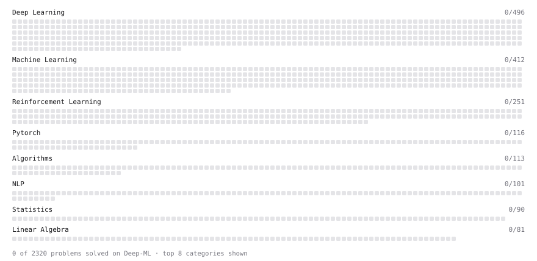

# Deep-ML

My machine learning practice from [Deep-ML](https://www.deep-ml.com). Every solution here was written by hand.

**4** solved · 0 problems · 0 labs · 4 math

[**Browse the interactive portfolio**](https://AI-Oke.github.io/deep-ml/) to replay this filling in over time.

## Math

| | Difficulty | Solved | |
| --- | --- | --- | --- |
| [Derivatives and Gradients](https://www.deep-ml.com/math-problems/1) | easy | 2026-11-17 | [solution](math/0001-derivatives-and-gradients) |
| [Inverse and Rank](https://www.deep-ml.com/math-problems/12) | medium | 2026-11-17 | [solution](math/0012-inverse-and-rank) |
| [Least Squares and the Normal Equations](https://www.deep-ml.com/math-problems/34) | medium | 2026-11-17 | [solution](math/0034-least-squares-and-the-normal-equations) |
| [Interpolation and Double Descent](https://www.deep-ml.com/math-problems/118) | hard | 2026-11-04 | [solution](math/0118-interpolation-and-double-descent) |

---

_This file is regenerated by Deep-ML on every push._
